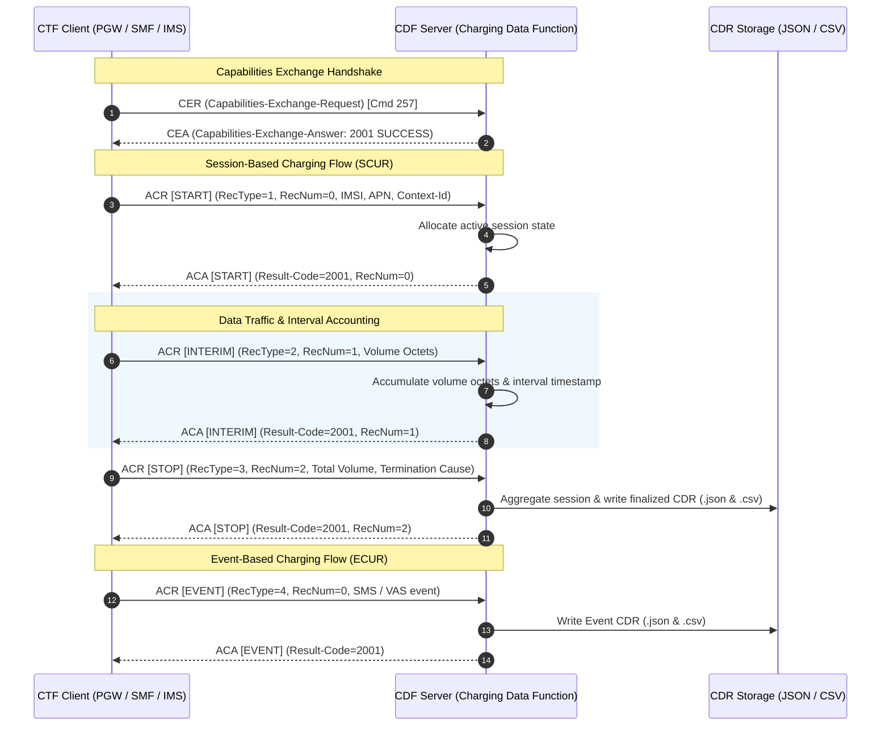

# 3GPP Diameter Rf Offline Charging Simulation (CDF & CTF)

A complete simulation suite for **3GPP Offline Charging** implementing both the **Charging Data Function (CDF)** and the **Charging Trigger Function (CTF)** over the **Diameter Rf** interface.

This repository provides two interoperable implementations:
1. **Seagull Simulation Suite**: Production XML dictionaries, scenario files, environment configurations, and scripts for the industry-standard [Seagull](https://github.com/codeghar/Seagull) telecom traffic generator (with Docker support).
2. **Pure Python Simulation Suite**: Zero-dependency, standalone binary RFC 6733 / 3GPP TS 32.299 Diameter protocol codec, stateful CDF server with CDR generation (JSON + CSV), and multi-mode CTF client.

---

## 1. 3GPP Charging Architecture & Rf Interface

According to **3GPP TS 32.240** and **3GPP TS 32.299**:
* **CTF (Charging Trigger Function)**: Embedded in network functions (e.g. PGW, SMF, UPF, IMS P-CSCF/S-CSCF). It detects chargeable network events and sends Diameter `Accounting-Request` (ACR) messages over the **Rf reference point**.
* **CDF (Charging Data Function)**: Receives ACR messages from CTFs, correlates session-based records (Start, Interim, Stop) or event-based records, generates standard **Charging Data Records (CDRs)**, and sends back `Accounting-Answer` (ACA) with Result-Code `2001 (DIAMETER_SUCCESS)`.
* **CGF (Charging Gateway Function)** / **BD (Billing Domain)**: Consumes generated CDRs for rating, billing, and invoicing.



---

## 2. Directory Structure

```
cdf_seagull_simulation/
├── README.md                          # Project documentation and guide
├── Dockerfile.seagull                 # Seagull Linux container image
├── docker-compose.yml                 # Docker Compose orchestrating CDF & CTF
├── seagull/                           # Seagull traffic generator assets
│   ├── config/
│   │   ├── base_rf.xml                # Diameter Base + 3GPP Rf XML dictionary
│   │   ├── conf_cdf_server.xml        # CDF Server Seagull config (TCP 3868)
│   │   └── conf_ctf_client.xml        # CTF Client Seagull config
│   ├── scenario/
│   │   ├── cdf_server.xml             # CDF Server scenario (CER->CEA, ACR->ACA)
│   │   ├── ctf_session_client.xml     # CTF Client scenario: Start -> Interim -> Stop
│   │   └── ctf_event_client.xml       # CTF Client scenario: Event ACR (SMS/VAS)
│   ├── data/
│   │   └── subscribers.csv            # Test subscriber dataset for multi-session injection
│   └── scripts/
│       ├── run_cdf.sh / run_ctf.sh    # Linux Bash execution scripts
│       ├── run_cdf.ps1 / run_ctf.ps1  # Windows PowerShell scripts
│       └── run_cdf.bat / run_ctf.bat  # Windows Batch scripts
├── python/                            # Pure Python Standalone Implementation
│   ├── diameter_rf.py                 # RFC 6733 + 3GPP TS 32.299 binary encoder/decoder
│   ├── cdr_manager.py                 # CDR session state tracking & JSON/CSV generator
│   ├── cdf_server.py                  # Standalone multi-threaded CDF TCP Server
│   ├── ctf_client.py                  # Interactive/Batch CTF TCP Client
│   └── test_simulation.py             # End-to-end automated unit & integration tests
└── cdrs/                              # Output directory for generated CDRs
    ├── cdrs_summary.csv               # Aggregated CDR CSV ledger
    └── CDR_*.json                     # Individual detailed 3GPP CDR files
```

---

## 3. Running with Seagull

### Option A: Using Docker (Recommended for any OS)
If you have Docker installed, you can build and launch both CDF and CTF without compiling Seagull natively:

```bash
# 1. Build the Seagull container image
docker compose build

# 2. Run CDF Server in the background
docker compose up -d cdf

# 3. Run CTF Client (Session-based by default)
docker compose run --rm ctf

# Or run Event-based scenario:
docker compose run --rm ctf /opt/seagull/run_ctf.sh event
```

### Option B: Using Native Seagull Binary (Linux / Cygwin)

#### 1. Start CDF Server
```bash
seagull -conf seagull/config/conf_cdf_server.xml \
        -dico seagull/config/base_rf.xml \
        -scen seagull/scenario/cdf_server.xml \
        -log logs/cdf_server.log \
        -llevel E
```

#### 2. Run CTF Client (Session-Based Charging)
```bash
seagull -conf seagull/config/conf_ctf_client.xml \
        -dico seagull/config/base_rf.xml \
        -scen seagull/scenario/ctf_session_client.xml \
        -log logs/ctf_client.log \
        -llevel E
```

#### 3. Run CTF Client (Event-Based Charging)
```bash
seagull -conf seagull/config/conf_ctf_client.xml \
        -dico seagull/config/base_rf.xml \
        -scen seagull/scenario/ctf_event_client.xml \
        -log logs/ctf_client.log \
        -llevel E
```

---

## 4. Running with the Standalone Python Simulation

The Python simulation has **no external package dependencies** (uses only standard Python 3.8+ libraries) and is immediately runnable on Windows, macOS, and Linux.

### 1. Start the CDF Server
```bash
python python/cdf_server.py --port 3868 --cdr-dir cdrs
```
*Options:*
* `--host`: Interface to bind (default: `0.0.0.0`)
* `--port`: Port to listen (default: `3868`)
* `--origin-host`: Diameter Host Identity (default: `cdf.rf.telecom.org`)
* `--origin-realm`: Diameter Realm (default: `rf.telecom.org`)
* `--cdr-dir`: Folder to write generated CDR files (default: `cdrs`)
* `--verbose`: Enable detailed protocol tracing

### 2. Run CTF Client Simulation

#### Mode 1: Session-Based Charging (SCUR)
Simulates a subscriber establishing a data session (e.g. 4G/5G PDU session), exchanging interim usage reports, and closing the session:
```bash
python python/ctf_client.py --mode session --imsi 001010123456789 --msisdn 491701234567 --apn internet --duration 4 --interim-interval 2 --volume-mb 10
```

#### Mode 2: Event-Based Charging (ECUR)
Simulates an immediate one-off chargeable event (e.g. SMS delivery or VAS):
```bash
python python/ctf_client.py --mode event --imsi 001010987654321 --msisdn 491709876543
```

#### Mode 3: Batch Multi-Subscriber Simulation
Iterates through `seagull/data/subscribers.csv` to simulate multiple real-world subscribers:
```bash
python python/ctf_client.py --mode batch --csv seagull/data/subscribers.csv
```

---

## 5. Automated Verification & Integration Tests

The project includes an end-to-end integration test (`python/test_simulation.py`) that:
1. Spawns the CDF Server on a test port.
2. Runs the full CTF session charging exchange (CER/CEA, ACR Start, ACR Interim, ACR Stop).
3. Runs the CTF event charging exchange (ACR Event).
4. Verifies all ACA answers have `Result-Code: 2001 (DIAMETER_SUCCESS)`.
5. Verifies CDR files are created and validates subscriber IDs, duration, and volume totals.

To run the automated tests:
```bash
python python/test_simulation.py
```

Expected output:
```text
----------------------------------------------------------------------
Ran 3 tests in 2.799s

OK
[TEST PASS] Session CDR Verified
[TEST PASS] Event CDR Verified
[TEST PASS] CSV Summary has 4 CDR entries recorded.
```

---

## 6. Generated CDR Format

The CDF generates two output formats in `cdrs/`:

### A. Individual JSON CDR (`CDR_SESSION_*.json`)
```json
{
  "cdr_id": "CDR-SES-1795445594-session_01",
  "record_type": "SESSION_PDU_CHARGING_DATA_RECORD",
  "3gpp_spec": "3GPP TS 32.251 / TS 32.299",
  "session_id": "ctf.test;1795445592;session_01",
  "subscriber": {
    "imsi": "001010999888777",
    "msisdn": "491709998887"
  },
  "network_element": {
    "ctf_host": "ctf.test.rf.telecom.org",
    "apn_dnn": "test.internet.apn",
    "service_context_id": "32251@3gpp.org"
  },
  "session_timing": {
    "start_time": "2026-11-23 20:23:12",
    "stop_time": "2026-11-23 20:23:14",
    "duration_seconds": 2.01
  },
  "traffic_volume": {
    "uplink_input_octets": 349525,
    "downlink_output_octets": 699051,
    "total_volume_octets": 2097152,
    "total_volume_mb": 2.0
  },
  "closure_reason": "DIAMETER_LOGOUT",
  "interim_updates_count": 2,
  "generated_at": "2026-11-23 20:23:14"
}
```

### B. Consolidated CSV Ledger (`cdrs_summary.csv`)
Columns:
`Record_Sequence, Record_Type, Session_Id, IMSI, MSISDN, APN, Service_Context_Id, Start_Time, Stop_Time, Duration_Sec, Input_Octets, Output_Octets, Total_Octets, Cause_For_Closing, CTF_Host, Generated_At`

---

## 7. Cross-Interoperability

Because both Seagull and the Python simulation adhere to RFC 6733 Diameter wire framing and 3GPP TS 32.299 AVP formats over TCP:
* **Python CDF Server** can accept traffic from **Seagull CTF Client**.
* **Seagull CDF Server** can accept traffic from **Python CTF Client**.
